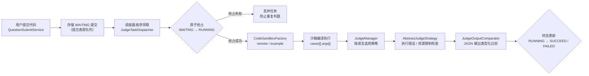

# MyOJ 在线判题系统 · 后端

> 一个像 LeetCode 一样的在线编程判题平台后端：用户提交代码，系统在远程沙箱中隔离执行，自动判定结果。

    

---

## 功能特性

- **多语言判题**：支持 Java、C++、Go、Python、JavaScript，按语言自动选择资源限制策略
- **远程沙箱隔离**：用户代码在独立沙箱中编译执行，后端永不接触用户代码的运行环境
- **排队判题**：提交后立即返回，调度器按提交顺序派发，限制同时判题数保护沙箱，进程重启后自动续判
- **结构化用例**：题目定义输入参数与输出类型，沙箱只做原始编译执行，判题结果由后端类型化比较
- **安全鉴权**：沙箱调用采用 ECDSA 请求签名，防伪造、防重放
- **防重复判题**：`WAITING → RUNNING → SUCCEED | FAILED` 状态机 + 条件更新，保证同一提交只判一次
- **完整的管理能力**：用户注册登录、题目增删改查、提交记录查询、管理员权限（`@AuthCheck` + AOP）
- **开箱即用的接口文档**：Knife4j 在线文档（dev 环境）

## 判题架构



- **代码沙箱**：`CodeSandbox` 接口 + 工厂模式按配置切换实现 + 代理模式做日志增强
- **判题策略**：策略模式管理各语言资源配额，`AbstractJudgeStrategy` 统一执行错误与超限检查
- **结果语义**：提交状态 `SUCCEED` 表示判题流程完成；最终 verdict、首个失败用例或沙箱诊断保存在 `judgeInfo.message`

## 技术栈

| 技术 | 版本 | 用途 |
|------|------|------|
| Java | 21 | 开发语言（虚拟线程异步判题） |
| Spring Boot | 3.5.16 | 基础框架 |
| MyBatis-Plus | 3.5.17 | ORM |
| MySQL | 8.4 | 数据库 |
| Knife4j | 4.4.0 | 接口文档（OpenAPI 3） |
| Hutool | 5.8.47 | 工具库 |
| Docker | - | 一键部署（MySQL + 后端） |

## 快速开始

**前置条件**：JDK 21、Maven 3.6.3+；开发数据库用 Docker 一键启动（或自备 MySQL 8）。clone 后不需要创建任何配置文件。

```bash
# 1. 启动开发数据库（MySQL 8.4，账号 root / oj_dev；首次启动自动建表，并创建管理员 admin / 12345678）
docker compose -f deploy/docker-compose.dev.yml up -d

# 2. 启动后端（自动激活 dev profile，默认使用模拟沙箱，监听 127.0.0.1:8102）
mvn spring-boot:run
```

- **没有 Docker**：自行安装 MySQL 8，执行 `mysql -uroot -p < sql/create_table.sql`；root 密码不是 `oj_dev` 时，用环境变量 `MYSQL_PASSWORD` 覆盖。
- **在 IDE 里运行** `MainApplication`：加 VM 参数 `-Dspring.profiles.active=dev`。
- **联调真实沙箱**（[my-oj-sandbox](https://github.com/Huangjl-cn/my-oj-sandbox)）：`CODESANDBOX_TYPE=remote CODESANDBOX_URL=http://<沙箱地址>:8100 mvn spring-boot:run`。开发用的签名密钥对已内置，与沙箱的 dev 配置配对。
- **其他开发配置**都可以用环境变量覆盖，见 `src/main/resources/application-dev.yml`；也可以在项目根目录建 `config/application-dev.yml`（已被 gitignore）。

接口文档：http://localhost:8102/api/doc.html

## 测试

```bash
mvn test   # 不依赖数据库和沙箱

# 调用真实沙箱的集成测试默认跳过，需要时：
RUN_SANDBOX_TESTS=true CODESANDBOX_URL=http://<沙箱地址>:8100 mvn test -Dtest=CodeSandboxTest
```

## Docker 部署

服务器上只需要 `deploy/` 目录。在开发机上准备好后上传：

```bash
mvn clean package
cp target/my-oj.jar deploy/oj-backend/my-oj.jar        # 应用
cp sql/create_table.sql deploy/oj-backend/init.sql      # 首次初始化数据库时执行的建表脚本
cp deploy/.env.example deploy/.env                      # 首次部署：填写变量（见下表），之后保留服务器上的 .env
# 上传 deploy/ 到服务器后，在服务器的 deploy 目录执行：
docker compose up -d --build
```

- 启动 MySQL（宿主机 127.0.0.1:3307）、后端（127.0.0.1:8101）和前端 nginx（80/443）。前端的静态文件、`nginx.conf` 和证书放在 `deploy/oj-frontend/`，来自前端仓库。
- 镜像固定使用 prod profile，接口文档和 SQL 日志关闭。
- 应用使用只授权 `oj_db` 的 `oj_app` 账号；root 只能在容器内登录：`docker exec -it my-oj-db mysql -uroot -p`。账号在首次初始化数据卷时创建。

部署所需的环境变量（写在 `deploy/.env`，不入库）：

| 变量 | 说明 | 秘密 |
|---|---|---|
| `MYSQL_ROOT_PASSWORD` | MySQL root 密码，只用于运维 | 是 |
| `MYSQL_PASSWORD` | 应用账号 `oj_app` 的密码 | 是 |
| `CODESANDBOX_URL` | 沙箱地址，不带 `/executeCode`，如 `http://10.0.0.2:8100` | 否 |
| `CODESANDBOX_AUTH_KEY_ID` | 签名 key-id，与沙箱生产配置一致 | 否 |
| `CODESANDBOX_AUTH_PRIVATE_KEY` | 签名私钥（Base64 PKCS#8），生成方法见[沙箱调用鉴权](./docs/sandbox-auth/README.md) | 是 |

## 项目结构

```
src/main/java/com/hjl/oj/
├── controller/        # HTTP 接口层
├── service/           # 业务逻辑层
├── judge/             # 判题模块（核心）
│   ├── codesandbox/   # 代码沙箱：工厂 + 代理模式、请求签名
│   ├── queue/         # 判题调度器：按序派发、并发限制、卡死恢复
│   └── strategy/      # 判题策略：策略模式
├── mapper/            # MyBatis-Plus 数据访问层
├── model/             # dto / entity / enums / vo
├── aop/               # 请求日志、权限校验切面（@AuthCheck）
├── annotation/        # 自定义注解
├── config/            # 配置类（JSON、MyBatis-Plus、沙箱签名等）
├── common/            # 统一返回、错误码
├── constant/          # 常量
├── exception/         # 业务异常与全局异常处理
└── utils/             # 工具类
```

## 相关仓库

- [my-oj-sandbox](https://github.com/Huangjl-cn/my-oj-sandbox)：代码沙箱，在 Docker 容器中隔离编译、执行用户代码。本地联调见上面的“联调真实沙箱”。
- 前端：单独的仓库，部署时把构建产物放到 `deploy/oj-frontend/`。

## 更多文档

- [代码沙箱接口契约](./docs/sandbox-contract.md)
- [沙箱调用鉴权](./docs/sandbox-auth/README.md)（ECDSA 签名、密钥生成与轮换）
- [前端对接说明](./docs/frontend/)
- [开发约定](./AGENTS.md)（架构、配置、测试、提交规范）
- [数据库建表脚本](./sql/create_table.sql)

## License

[MIT](./LICENSE)
